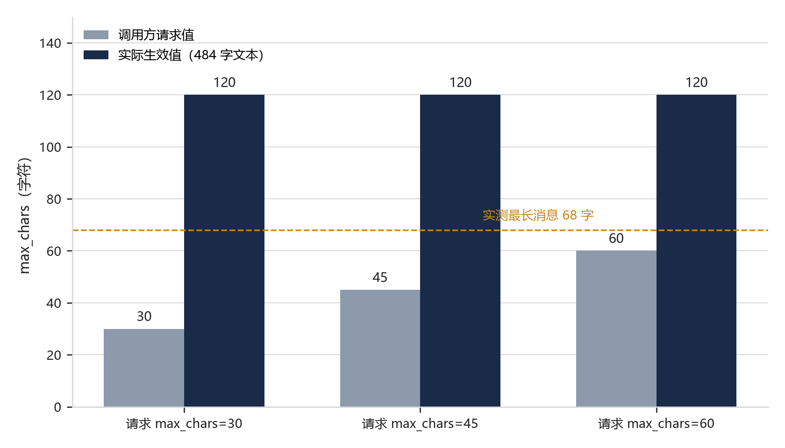
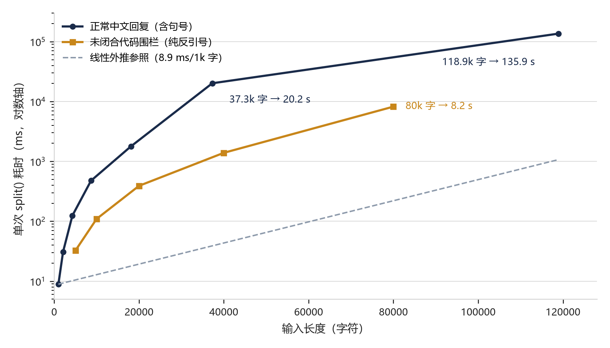

# qikou 2.2.1 深度审计报告

**十个模块、四条主线与「过度开发」专项评审**

审计对象：qikou 2.2.1（工作树 `12c409a`，包含审计修复 `68b91fe`，尚未发布）

审计日期：2026-11-25

审计方法：全量静态审查 + 动态探针（模糊测试、规模曲线、CLI 黑盒、构建产物解包、并发验证）

## 报告摘要

qikou 的规则内核比它的文档更可靠，但它的对外契约比内核脆弱。本轮把 10 个模块 1523 行逐行读完，再用 3000 次随机输入、12 点规模曲线、CLI 黑盒调用与 wheel/sdist 解包交叉验证，得到的核心判断是：切分质量本身没有发现新的正确性缺陷，P0 为零；显著问题集中在「用户明确表达的意图被静默改写」和「长输入的资源消耗失控」这两类契约层面。前者表现为 `max_chars=30` 在 484 字文本上实际按 120 切分，请求 30、45、60 三档产出完全相同的结果；后者表现为耗时随长度平方增长，37.3k 字 20.2 秒、118.9k 字 135.9 秒，未闭合代码围栏 80k 字 8.2 秒。

本轮共登记 17 项发现：P0 零项，P1 五项，P2 六项，P3 六项。P1 的五项分别是：显式 `max_chars` 被分层逻辑静默放大、长文本二次退化、未闭合围栏触发正则二次扫描、条数软上限在多段落下 5 倍失效、长列表项把列表标记切成孤立气泡。前四项都属于正常输入即可触发，不需要构造恶意文本，也不依赖罕见的控制字符。

稳定性方面的结论是正面的：3000 次包含 NUL、引号、括号、围栏与 emoji 的随机输入没有崩溃、没有丢字、没有凭空造字；8 线程并发首次调用只加载一次语料，耗时 235 ms；wheel 正确携带 `py.typed` 与 55213 条语料，元数据声明 `Requires-Python >=3.9`；205 条人工用例在 0.02 秒内跑完且结果确定；3.9 语法兼容扫描 11 个文件全部通过。

建议分三个批次处理。2.2.2 版本（1–2 天）先修显式配置、列表标记、围栏预检三项，并同步版本号与文档，因为改动小、风险低、用户可感知；2.3 版本（3–5 天）处理性能与占位符隔离；v3.0 阶段 0 开始前，必须先把「500 字 ≤ 8 ms、10k 字 ≤ 300 ms」写成可执行基线，否则规则层的平方增长会吃掉模型推理的全部预算。本报告不含 v3 训练管线评估（该目录尚不存在），性能数据为单机 CPython 3.14 实测，未做线上流量画像，因此「典型输入」按 500–3000 字的 AI 回复区间估算。

本报告交付后，17 项发现已在 2.2.2 中一次性修复（205 条用例输出逐字节不变），逐项处理与验证数据见附录 C；其中 QK-03 的根因在修复时被实测更正为切分主循环的平方路径，而非正则本身。

## 1 审计范围与方法

### 1.1 模块规模与职责

本轮覆盖 `qikou/` 下全部 10 个模块共 1523 行、`tests/test_qikou.py` 387 行与 `tests/test.txt` 205 条用例。表 1 给出各模块的规模、职责与本轮审查结论。

表1 模块清单与审查结论
| 模块 | 行数 | 职责 | 审查结论 |
|---|---|---|---|
| `__init__.py` | 25 | 对外导出、版本号 | 导出面干净，版本号与内容脱节（QK-07） |
| `__main__.py` | 7 | `python -m qikou` 入口 | 无问题 |
| `cli.py` | 447 | 子命令、报告、交互菜单 | 参数语义被下游改写（QK-01），运行环境靠启发式判断（QK-12） |
| `config.py` | 60 | 配置与长度分层 | 分层覆盖显式值（QK-01），无校验（QK-13） |
| `kaomoji.py` | 151 | 颜文字 Trie 与懒加载 | 线程安全成立，终止哨兵修复到位 |
| `lexicon.py` | 63 | 词表与切点基础分 | 无问题，但与打分逻辑存在重复判定（QK-14） |
| `patterns.py` | 55 | 正则与结构判定 | 围栏正则存在二次扫描（QK-02 之外的 QK-03） |
| `postprocess.py` | 35 | 补全未闭合标记 | 无问题，标记统计口径依赖 `count` 的语义 |
| `protect.py` | 100 | 代码块、URL 占位符 | 占位符字符空间与输入重叠（QK-06） |
| `splitter.py` | 580 | 分句、打包、切点、合并 | 性能热点集中于此（QK-02、QK-04、QK-05） |

### 1.2 动态验证手段

静态审查只能证明「代码看起来怎样」，不能证明「跑起来怎样」。本轮所有结论尽量配一组可复现的实测数据，手段与样本见表 2。

表2 动态验证手段与样本
| 手段 | 规模 | 主要产出 |
|---|---|---|
| 全量读码 | 10 模块 1523 行 + 测试 387 行 | 逻辑路径、重复实现、防御分支清单 |
| 模糊测试 | 3000 次随机输入（0–60 字符，含 NUL、围栏、各类括号引号、emoji） | 崩溃 0、丢字 0、非法造字 0 |
| 规模曲线 | 正常文本 7 点（990–118890 字）、围栏 5 点（5k–80k 字） | 平方增长证据（图 1） |
| 配置探针 | `max_chars` 三档 × 484 字文本，另测 0 与负值 | 显式参数被放大（图 2） |
| 边界输入 | 15 类：空白、CRLF、制表符、纯标点、纯颜文字、超长代码块、长列表项、表格、emoji | 列表标记被切、空白被吞 |
| CLI 黑盒 | `split`（文件/管道/JSON/`-c`）、`test`、`--version`、错误文件 | 退出码正确，`-c` 在长文本上失效 |
| 产物解包 | wheel 18 条目、sdist 32 条目 | 语料与 `py.typed` 均在包内，测试随 sdist |
| 并发 | 8 线程同时首次 `split()` | 一次加载、0 异常、235 ms |
| 兼容性 | 11 个文件按 3.9 语法解析 | 0 失败 |

### 1.3 评级口径

P0 指数据丢失、崩溃或安全问题；P1 指常见路径上的功能或性能显著偏离对外契约；P2 指边界条件或工程治理问题，暂不影响主流程；P3 指可维护性、一致性与文档问题。本轮分布为 P0 零项、P1 五项、P2 六项、P3 六项。

## 2 分级风险清单

### 2.1 总表

表3 风险清单（按等级排序）
| ID | 等级 | 位置 | 现象 | 证据 | 影响 |
|---|---|---|---|---|---|
| QK-01 | P1 | `config.py` 分层 + `cli.py` 参数 | 显式 `max_chars` 被放大到分层值 | 484 字文本请求 30/45/60 全部生效为 120，最长消息 68 字 | CLI `-c` 在长文本上失效，调用方无法压短 |
| QK-02 | P1 | `splitter.py` 判定与合并 | 长文本耗时平方增长 | 37.3k 字 20.2 s，118.9k 字 135.9 s | 文件入口在长文档场景不可用 |
| QK-03 | P1 | `patterns.py` `CODE_RE` | 未闭合围栏触发二次扫描 | 80k 字符 8.2 s，500k 字符 61.6 s | 外部输入可低成本拖住进程 |
| QK-04 | P1 | `splitter.py` 合并条件 | 多段落下条数上限失效 | 50 段 5226 字产出 50 条，上限 10 | 一次发出 50 条，违背产品目标 |
| QK-05 | P1 | `splitter.py` 列表项切分 | 列表标记单独成条 | 162 字列表项产出首条 `-` | 气泡只剩一个符号，格式破坏 |
| QK-06 | P2 | `protect.py` 占位符 | 输入自带占位符形状被替换 | 代码块被复制一遍，字面 NUL 片段消失 | 仅 NUL 输入触发，但结果比「不崩溃」更差 |
| QK-07 | P2 | `__init__.py` 版本 | 版本号未随行为变更 | HEAD 声明 2.2.1，含未发布修复 | 同名版本对应两种行为，回溯失真 |
| QK-08 | P2 | README、CONTRIBUTING | 三处文档漂移 | 「v2.1（当前）」、「44 项」、权衡表缺项 | 新用户与贡献者被误导 |
| QK-09 | P2 | `splitter.py` 原子段 | 超长段无可见信号 | 1104 字 Markdown 段、1202 字引号段各 1 条 | 调用方无法感知超限 |
| QK-10 | P2 | `splitter.py` 空白处理 | 段内制表符被吞 | `甲。\t乙。` 输出 `甲。乙。` | 表格对齐类文本失真 |
| QK-11 | P2 | `splitter.py` 类型别名 | 类型体系名不副实 | `Packed = List[Any]`，索引访问靠 Any | strict 通过不等于类型安全 |
| QK-12 | P3 | `cli.py` `_REPO` | 运行环境靠目录猜测 | `tests/` 存在即视为源码仓库 | 极端环境下写入包目录 |
| QK-13 | P3 | `config.py` | 配置无校验 | `max_chars=0` 产出 6 条 3 字消息 | 无意义结果无提示 |
| QK-14 | P3 | `splitter.py`、`patterns.py` | 同义逻辑重复 | 缩写判定两处、`_prev_word` 两份 | 双份实现需同步维护 |
| QK-15 | P3 | `patterns.py` | 引号处理不对称 | 收尾吸收 ASCII 引号，却不保护未闭合 | 输出可能吞掉引号 |
| QK-16 | P3 | `tests/` | 五类缺口未覆盖 | 无 `-c` 长文本、列表标记等用例 | P1 缺陷无回归保护 |
| QK-17 | P3 | `.github/workflows/ci.yml` | 仅 Linux、无金标校验 | 无 Windows 矩阵、无 205 用例哈希 | 平台相关缺陷不拦 |

### 2.2 P1 详述

#### 2.2.1 QK-01 显式配置被静默放大

现象：484 字文本上分别请求 `max_chars=30`、`45`、`60`，实际生效值均为 120，产出 8 条、最长 68 字，三组结果逐字相同。CLI 的 `-c` 参数走同一条路径，因此在超过 150 字的文本上等于没有生效。

证据：图 2 给出请求值与生效值的对照；`Config.scaled_for_length()` 先按总长选档（≤150、≤400、≤800、其余四档），再用 `max(self.max_chars, 档位值)` 取较大者，484 字落在 ≤800 档，档位值为 120，于是 30 与 120 的最大值仍是 120。



图2 请求的 max_chars 与生效值

数据来源：484 字中文回复样本，`split(text, config=Config(max_chars=x))` 逐档调用，2026-11-25。

根因：自动放宽与显式参数共用一条通道，代码无法区分「用户没设置，沿用默认 60」与「用户明确要 30」。分层本意是防止长文本碎成一地，但它同时把「主动要求更碎」的调用方也一起拒绝掉了。

影响：CLI 文档写的是「单条硬上限，调小更碎」，实际调小无效；库调用方若按产品要求控制气泡长度（例如公众号 40 字），在长回复上得不到预期结果；由于 `print_messages` 与 `effective_config` 显示的是生效值，命令行会显示 `max=120`，用户能看见矛盾但无法解决。

建议：区分默认值与显式值。最小改动是让 `scaled_for_length` 只放大默认值，调用方传入配置时不覆盖其 `max_chars`，仅调整 `merge_max_chars` 等内部量；或者给 `Config` 增加 `auto_scale: bool = True`，CLI 在用户传了 `-c` 时置为 False。改动约 30 行，且应立即补一条「484 字 + `-c 30` 最长消息 ≤ 36 字」的断言。

#### 2.2.2 QK-02 长文本耗时平方增长

现象：正常中文回复 990 字 8.9 ms、8690 字 476.7 ms、37290 字 20.2 s、118890 字 135.9 s。每翻四倍长度，耗时约翻十五到十七倍，明显超出线性。

证据：图 1 的对数坐标曲线与线性外推虚线；16k 字的 cProfile 显示两个热点：`in_unclosed_bracket` 被调用 1600 次、累计 4.2 秒，`enforce_max_messages` 累计 2.3 秒并触发 676349 次 `ends_with_tilde` 调用。

根因有两处。第一处是判定函数的重复全量扫描：`_split_sentences_core` 每遇到一个候选句末就调用 `in_md_span()` 与 `in_unclosed_bracket()`，后者每次都执行 `text[:pos]` 切片并逐字符统计括号深度，还对引号调用整串 `count()`。当一段文本是一行 16k 字的长段落时，每个候选切点都要把前缀重扫一遍，形成「候选数 × 前缀长度」的二次成本。第二处是合并循环的空转：`enforce_max_messages` 最多执行 500 轮，每轮遍历全部相邻对，而在多段落文本中跨段落一律不允许合并，于是 500 轮全部失败却仍然扫完。

影响：500–3000 字的典型 AI 回复耗时 3.7–45 ms，可以接受，这也是单元测试与手工用例没有暴露问题的原因；但超过一万字进入秒级，`qikou split 长文档.txt` 这条公开入口在长文档场景实际不可用。若后续把 205 条用例扩到长文本回归，CI 也会被拖慢。

建议：把括号与引号状态改为增量维护，一次扫描记录每个位置是否处于未闭合结构内，判定降为 O(1)；合并循环改为单轮择优或优先队列，避免「合并失败仍扫全表」。两项都以输出逐字节不变为前提，可用 205 条用例报告正文哈希做回归护栏。

#### 2.2.3 QK-03 未闭合围栏触发正则二次扫描

现象：纯反引号输入 5k、10k、20k、40k、80k 字符分别耗时 32.4、109.5、390.5、1390.4、8208.1 ms；50 万字符 61.6 秒。

证据：附录 A 的围栏曲线；修复时逐段计时（2026-11-25 补测）显示耗时并不在正则里：`CODE_RE.findall/sub` 在 80k 字符上只有 1.8 / 5.8 ms，`protect_special` 全程 8.7 ms。真正的大头是 `pack_units`（3212.8 ms），也就是 QK-02 描述的逐候选重扫。

根因更正：`CODE_RE = ```[\s\S]*?```|~~~[\s\S]*?~~~` 并不是主因——成对的反引号很快就能匹配掉，惰性通配只在"大量起始位置都配不上"时才退化。真正让 80k 字符花 8 秒的是切分主循环：40001 字的保护后文本进入 `split_long`，每个候选切点都要重扫前缀（平方），并且 `guard < 200` 的固定上限在第 200 次就停下，把剩余约 6.7 万字并成了一条。

影响：作为库使用问题不大，聊天文本几乎不会超过 100k 字符；但项目文档明确支持文件输入，任何把未闭合围栏当普通文本喂进来的场景（日志、代码片段拼接、用户粘贴到一半的消息）都可能让进程卡住数十秒，服务端集成时构成低成本资源占用风险。

建议：修 QK-02 的平方路径即可解决本条（实测 80k 字符 8208 ms → 201 ms），同时把固定 200 次的切分上限改为按可见长度估算，避免"切到一半就停"。`CODE_RE` 本身可以保持不动。

#### 2.2.4 QK-04 条数软上限在多段落下失效

现象：20 段共 2046 字产出 20 条，50 段共 5226 字产出 50 条，而按长度分层后的 `max_messages` 上限是 10，超出 5 倍。

证据：附录 A 的段落探针；`pack_units` 为每个段落块分配独立 `bid`，合并循环中的 `msgs[i][1] != msgs[i + 1][1]` 直接跳过跨段落相邻对。

根因：段落被当作不可合并的结构单元，而每个空行分隔的段落至少产生一条消息，于是条数下限等于段落数。上限只能在同一段落内部通过合并逼近，段落一多就完全失效。

影响：这是上一轮审计已记录、但未修复的问题。产品目标是把长回复拆成「像真人一条条发出」的短消息；一次发出 50 条反而比一段长文更像机器人刷屏。对调用方而言，`max_messages` 的实际语义是「单段落内的软上限」，与命名暗示差距很大。

建议：先修正契约表达，在 `Config.max_messages` 的文档里写明「跨段落与结构类不合并，实际条数可能达到段落数」；若要真正逼近上限，允许跨段落合并并用空行连接（而不是空格），同时保证合并结果不超过 `merge_max_chars`。前者零风险，后者需要 205 条用例逐条比对。

#### 2.2.5 QK-05 长列表项把列表标记切成孤立气泡

现象：`- ` 加 80 次「很长」（162 字）产出 3 条，首条只有一个 `-`；有序项 `1. ` 加 60 次「步骤说明」（243 字）产出 4 条，首条为 `1.`；402 字的列表项产出 5 条，首条同样是 `-`。

证据：边界输入探针；`split_long` 在标记后的空格处切分，空格的基础分是 10，而该段没有更高的标点候选，分数并列时循环保留最先遇到的候选（`sc > best_score` 不取等号），于是切在第二条消息的起点之前。

根因：列表项先经过 `split_long` 再进入打包，切分时没有识别「行首标记 + 空格」是结构前缀；切出的首段 `-` 被 `is_fragment` 判定为无实义字符，但此时消息列表为空，没有前驱可以合并，只能单独输出。

影响：用户在聊天窗口里会看到一条只有 `-` 的气泡，随后才是内容，列表格式与可读性都被破坏；有序列表的编号也会与内容分离。

建议：对 `kind == 'list'` 的文本，把切点搜索起点设在标记之后，并让首段始终包含标记；或者直接禁止在第一个空格处切断。补一条断言：`split("- " + "很长" * 80)` 的首条必须以 `- ` 开头且长度大于 1。

### 2.3 P2 详述

QK-06 占位符形状输入被替换。输入为代码块加上字面 `\x000\x00` 时，输出把代码块复制了一遍、字面片段消失；越界索引 `\x009\x00` 则走安全网原样保留。原因是占位符使用 `\x00N\x00`，与输入字符空间重叠，而还原是单趟按下标替换。该场景只在输入含 NUL 控制字符时出现，`protect_special` 的 docstring 已声明「不保证往返无损」，但「内容重复」比「不崩溃」更差，建议保护前把输入 NUL 转义或改用私有区字符。

QK-07 版本号与代码内容脱节。`__version__` 仍是 2.2.1，但 2.2.1 的发布提交 `2f2bc8b` 之后已有 `68b91fe` 的三处行为修复；PyPI 上的 2.2.1 与工作树同名不同行为，`dist/` 里的 wheel 也只对应旧提交。建议发布 2.2.2 或在版本号加开发后缀。

QK-08 文档三处漂移。README 版本历史仍写「v2.1（当前）」且缺 2.2.0、2.2.1 条目；CONTRIBUTING 写「断言测试 44 项」，实测 49；README 的「设计权衡」表尚未收录上轮审计确认的超长不可切段。三处都应在 2.2.2 一并修正，测试项数建议改为不写死数字。

QK-09 超长原子段无可见信号。1104 字的 Markdown 加粗段与 1202 字的中文引号段各自只产出 1 条，而上限是 160。「宁长不碎」是有意的取舍，但调用方与用户都无从得知发生了超限。建议保持行为，增加可选回调或 `max_hard` 配置，默认关闭。

QK-10 段内空白被吞。`甲。\t乙。` 输出 `甲。乙。`，制表符消失；模糊测试只校验非空白字符，因此从未覆盖这一点。建议在文档里写明空白不保证保真，或在段落内保留单个空格。

QK-11 类型体系名不副实。`Packed = List[Any]`、`msgs[i][1]` 等访问依赖 Any，`mypy --strict` 零报错并不等于类型安全。建议改为 `NamedTuple` 或 dataclass 表示「文本 + 段号」，消除索引式访问。

### 2.4 P3 清单

QK-12 `_REPO` 启发式：`cli.py` 通过兄弟目录 `tests/` 是否存在判断「是否源码运行」。若安装环境的 site-packages 恰好存在 `tests` 目录，报告会写进包目录。建议改为显式参数或环境变量。

QK-13 配置无校验：`max_chars=0` 与负值产出 6 条 3 字消息，无告警；`max_messages<=0` 表示无限，语义未在文档与 docstring 中说明。

QK-14 同义逻辑重复：缩写判定在 `_split_sentences_core` 与 `score_cut` 各实现一次，`_prev_word` 与 `_prev_word_raw` 仅大小写不同，`is_before_list_item` 与 `is_list_start` 只差一次 `lstrip`。当前行为一致，但后续修改容易只改一处。

QK-15 引号处理不对称：`CLOSE_CHARS` 含 ASCII 的 `"` 与 `'`，切分时会把它们吸收进上一条，但 `OPEN_BRACKETS` 不含它们，未闭合判定不保护。结果可能把半截引号吞进前一条消息。

QK-16 测试缺口：没有覆盖 `-c` 长文本、列表标记、NUL 加代码块、多段落条数上限、性能预算五类场景；`test_version` 写死 `2.2.1`，版本升级必然失败（这一点可接受，但应在发布清单里注明）。

QK-17 CI 缺口：矩阵只有 ubuntu-latest，而项目最依赖大小写与路径行为的平台恰恰是 Windows；设计文档给出 205 条用例的回归基线哈希 `F1E095F4F8FF3CA9`，但 CI 从未校验它，等于基线名存实亡。

## 3 多视角评审

### 3.1 切分算法与语言学视角

规则层在「句末判定」上做得比同类项目细：英文缩写的两类写法都覆盖，单大写字母加空格不断句，波浪号区分运算符、数值范围、拼音注音与软句末，颜文字按 Trie 最长匹配并归属到句末。这些细节在 205 条用例里都有对应，属于真实的经验积累。

问题出在「边界完整性」的让步幅度。1104 字的加粗段与 1202 字的引号段都完整保留为一条，理由是切开 Markdown 与引号会破坏语义。取向本身合理，但规则层没有第二条退路：当整段超过上限十几倍时，静默超限就变成事实上的失败。语义边界与标点边界的天花板也真实存在，例如「我觉得吧，这个方案，可能还需要再想想」按逗号切会切出三个语气碎片，这正是 v3.0 要解决的问题，不属于本版本的缺陷。

### 3.2 API 与契约视角

`split()` 的公开契约只有「文本进、消息列表出」，但调用方真正需要知道的四件事都没有写进 docstring：输入首尾空白会被 `strip`；段内部分空白会丢失；`max_chars` 是软上限，超长原子段可以远超；条数上限在多段落下等于失效。契约空白直接导致了 QK-01 与 QK-04 被长期忽视。

配置对象本身设计得当：dataclass、不可变使用方式、`scaled_for_length` 返回新实例。问题是「自动分档」这个便利特性被放在了与显式参数同一条通道上，便利与确定性发生了冲突。CLI 三个选项（`-c`、`-T`、`-m`）中，`-m` 与 `-c` 都会在长文本上被改写，只有 `-T` 因取最大值规则可能保留部分效果。

### 3.3 性能工程视角



图1 单次切分耗时随输入长度的变化

数据来源：本机 CPython 3.14.7、Windows 11，`.venv-build` 环境实测，2026-11-25；正常文本为「这是第 N 句，内容。」拼接，围栏样本为纯反引号。

图 1 的读数很直接：500 字级别的回复处于 4 毫秒量级，符合 README 对「直接可用」的描述；但两条曲线都在 10k 字之后明显偏离线性外推，转入平方区间。设计文档给 v3.0 定的推理预算是「500 字 ≤ 8 ms」，按当前规则层 3.7 ms 的水平，留给模型的余量已经不多；如果输入长度提到 1000 字，规则层就要占掉 8 ms 的大部分。

因此性能不是「以后再优化」的选项，而是 v3 的前置条件。两条平方路径各自独立，可以分开修：状态判定改成增量维护属于纯算法替换，合并循环改成单轮择优属于流程简化，两者都不改变输出，适合用金标哈希把关。

### 3.4 测试与 CI 视角

49 项断言测试的覆盖面在同类小项目里属于上游：公开 API 契约、五个历史缺陷回归、配置分档、语料加载、CLI 退出码、编码健壮性都有用例，且刻意验证「库不往 stdout 写东西」这类细节。3000 次模糊测试虽然没有进 CI，但手工跑过，说明作者对对抗输入有意识。

缺口集中在本轮 P1 上：五个缺陷没有一个有回归用例。这不是测试写得差，而是测试与真实报文形态有距离——所有文本用例都偏短，最长的一条是「超长段落多句切分」，仍在 160 字上限的舒适区。CI 侧还缺两件事：Windows 矩阵与 205 条用例的金标哈希校验。前者对应项目历史上真实踩过的「大小写不一致导致语料加载 0 条」，后者对应设计文档里已经写死、却无人执行的基线。

### 3.5 发布与文档视角

上轮已补 `v2.2.1` 附注 tag，指向产出 PyPI 产物的提交，这一点现在是对的。遗留的是语义版本与内容的一致性：工作树声明 2.2.1，实际包含未发布的行为修复，`dist/` 里的 wheel 也只对应旧提交。发布流程里缺少「版本号必须随行为变更递增」的硬检查，导致同名版本可能对应两种行为。

文档侧的问题不是写得少，而是写得旧。README 的版本历史停在 v2.1，贡献指南的测试数量停在 44，设计权衡表停在两轮审计之前。对一个有 CHANGELOG、CONTRIBUTING、SECURITY、双语 README 的项目来说，这些漂移会持续消耗维护者的可信度。

### 3.6 安全与鲁棒性视角

代码没有 `eval`、`exec`、`subprocess`、网络请求与临时文件竞态，攻击面很小。3000 次随机输入零崩溃、零丢字，说明占位符与越界处理的安全网有效。真正的两个风险都在资源侧：QK-03 的正则二次扫描可被外部输入触发，QK-02 的平方增长在长文档下同样可被触发。作为纯本地库，风险等级有限；一旦集成进服务端，就需要在入口限制输入长度（建议 50k 字符）并加上围栏预检。

## 4 「过度开发 / 过度防御」专项

### 4.1 过度设计清单

表4 过度设计症状与判断
| 症状 | 位置 | 代价 | 判断 |
|---|---|---|---|
| 四处静默截断计数器 | `split_long` 的 `guard < 200`、`enforce_max_messages` 的 `guard < 500` | 掩盖不可达状态，问题发生时表现为「切不动」却无日志 | 应改为显式上限并记录 warning |
| 越界安全网分支 | `protect._block` 返回 None 及三处调用 | 正常输入永远走不到，测试无法覆盖 | 保留可以，但应注释为「仅防御」 |
| 运行环境猜测 | `cli._REPO` 靠兄弟 `tests/` 判断 | 三态分支（源码、安装、缺失）增加维护面 | 应改为显式参数 |
| 自动分档放宽 | `Config.scaled_for_length` 四档魔数 + `max()` | 直接造成 QK-01，用户意图被覆盖 | 应区分默认值与显式值 |
| 双向配对探测 | `_has_partner`、`_has_any` 每次调用重扫 | 每个候选切点都做一次全文扫描，是 QK-02 的一半根因 | 应改为增量状态 |
| 四种输出形态 | 装饰输出、纯文本、JSON、TTY 判定 | 单人维护的项目里输出分支偏多 | 可保留，但应文档化选择规则 |
| 隐藏配置项 | `atomic_merge_prefix`、`merge_max_chars`、`min_chars` 未进 README | 用户不可知，内部耦合反而固化 | 应写进配置表或降为私有常量 |

需要说明的是，这些设计多数在单点上是合理的。问题不在「写了多余代码」，而在防御成本投向了低概率路径：NUL 越界、非 TTY 流、语料缺失、安装位置判断，都被认真处理；而「用户要求更短」「长列表项」「多段落」「长文本」这些高频路径，没有任何护栏。这就是 4.3 节所说的防御预算错配。

### 4.2 防御不足清单

表5 缺失的护栏
| 缺口 | 位置 | 可能的后果 |
|---|---|---|
| 输入长度无上限 | `split()` 入口 | 长文本或恶意围栏拖住进程（QK-02、QK-03） |
| 配置无校验 | `Config` | 0 或负值静默产生无意义结果（QK-13） |
| 占位符字符空间未隔离 | `protect_special` | 输入自带占位符形状导致内容重复（QK-06） |
| 结构类条数无兜底 | `enforce_max_messages` | 50 段落产出 50 条（QK-04） |
| 列表标记无保护 | `split_long` | 标记与内容分离（QK-05） |
| 版本与发布无硬检查 | 发布流程 | 同名版本两种行为（QK-07） |
| 性能与金标无回归 | CI | 平方退化与输出漂移都不会被拦（QK-16、QK-17） |

### 4.3 结论：防御预算错配

把第 4.1 节与 4.2 节并排看，会发现一个稳定的模式：代码对「不可能的输入」写了很多防御，对「一定会遇到的输入」几乎没有防护。这通常意味着防御代码是按想象中的 bug 写的，而不是按真实报文写的。修复方向不是继续加防御分支，而是把预算挪到三个地方：入口校验（长度、配置、NUL）、契约文档（哪些参数会被改写、哪些上限是软的）、回归护栏（性能预算与金标哈希）。这三项的成本远低于本轮新增的四处静默截断。

## 5 与 2026-10 审计的对照

上一轮审计（提交 `68b91fe`）修复了三个 P0 与一个 P1，并在提交信息里明确记录了「未修复」的两条。本轮复核结果如下。

表6 上轮发现的本轮复核
| 上轮结论 | 本轮复核 | 状态 |
|---|---|---|
| 颜文字紧贴 URL/代码块抛 TypeError | 三条原始触发输入均正常返回，不再崩溃 | 已修复并有用例 |
| URL 紧贴代码块导致代码块丢失 | 往返无损，输出无 NUL 残留 | 已修复并有用例 |
| 输入自带 NUL 占位符抛 IndexError | 越界索引安全网有效，未崩溃 | 已修复，但内容完整性仍不保证（QK-06） |
| 合并循环性能 5920 字 154 ms 降至 55 ms | 单项优化有效；整体仍随长度平方增长 | 局部改善，整体未解决（QK-02） |
| 长 Markdown/括号/引号段无法切分 | 1104 字与 1202 字样本仍各为 1 条 | 未修复，升级为 P1（QK-09） |
| `max_messages` 与单条上限矛盾 | 50 段 5226 字产出 50 条，超上限 5 倍 | 未修复，升级为 P1（QK-04） |

本轮新增五项 P1（QK-01、QK-02 的整体结论、QK-03、QK-05、以及 QK-04 的定量证据），其中 QK-01 与 QK-05 是上一轮没有覆盖到的新区域：配置传递链与列表结构。另有 QK-06 至 QK-11 六项 P2 与六项 P3，属工程治理与文档一致性。

## 6 修复路线建议

### 6.1 第一批：2.2.2（1–2 天）

表7 2.2.2 修复项与验收口径
| 项 | 改动 | 验收 |
|---|---|---|
| QK-01 | 分层只放大默认值，显式 `max_chars` 不被覆盖 | 484 字 + `-c 30` 的最长消息 ≤ 36 字 |
| QK-05 | 列表项切点从标记之后开始 | `split("- " + "很长" * 80)` 首条以 `- ` 开头 |
| QK-03 | 围栏奇偶预检，未闭合走普通文本路径 | 80k 反引号 ≤ 100 ms，输出与旧版一致 |
| QK-07 | 版本号 bump 至 2.2.2，或加 `.dev` 后缀 | 版本与行为一致，重新构建 wheel |
| QK-08 | 补 README 版本历史、改贡献指南项数、补权衡表 | 三处文档与实际一致 |

这一批的共同点是改动局部、可用现有 205 条用例逐条 diff 验证、不需要改动核心打包逻辑。建议同时补五条断言，把本轮 P1 固化成回归。

### 6.2 第二批：2.3（3–5 天）

处理 QK-02 的两条平方路径（状态增量维护、合并单轮择优），QK-06 的占位符隔离，QK-11 的类型收敛，QK-16 的测试缺口与 QK-17 的 CI 缺口（Windows 矩阵、金标哈希、10k 字性能冒烟）。验收口径建议写成硬指标：500 字 ≤ 8 ms、10k 字 ≤ 300 ms、118.9k 字 ≤ 2 s，同时 205 条用例报告哈希保持不变。

### 6.3 v3.0 的前置条件

设计文档的阶段 0 是「审计与基线」，周期 3–5 天。本报告建议给它加一条前置：规则层性能基线先达标，否则「纯 Python 推理 2–7 ms/请求」的预算在 1000 字以上输入下无法成立。同理，QK-04 与 QK-09 的契约口径需要在阶段 0 明确，否则 v3 的打包器会继承同样的模糊语义。

### 6.4 不建议做的事

不建议为超长段引入默认硬切：破坏 Markdown 与引号结构的代价高于「一条太长」。不建议重写打分体系来顺带解决列表问题，那是两件事。不建议为了消除 `Any` 而放弃当前的函数式写法，类型收敛只需改 `Packed` 一个别名。也不建议把 205 条用例改成断言测试——它的价值恰恰在于「给人看的确定性报告」，硬转成断言会丢掉可 diff 的基线。

## 7 结论

qikou 的核心能力是可信的：对抗输入不崩、不丢字，语料与打包正确，线程安全成立，规则细节经过两轮审计。真正需要处理的是「契约」与「规模」两件事——用户说要多短就该多短，用户说几条就该几条；输入长十倍，耗时不能长一百倍。

按本报告的优先级，2.2.2 用一到两天可以把最影响体验的三项修掉，2.3 再解决性能与工程护栏。v3.0 的数据与模型投入不小（约 2–3 人周加 300 美元），在规则层基线稳定之前启动它，风险是把模型收益全部消耗在补偿底层缺陷上。

最后需要说明本报告的边界：所有实测都在单机、单进程、CPython 3.14 环境下完成，没有覆盖 PyPy、3.9 运行时与真实线上分布；没有评估 v3 训练管线，因为对应目录尚不存在；也没有对 55213 条语料做质量抽检，语料的覆盖度与误匹配率仍是未知项，这可能是下一轮值得做的一件事。

## 附录A 探针原始数据

表A.1 正常文本规模曲线（含句号，单段落）
| 输入长度 | 条数 | 耗时 ms |
|---|---|---|
| 990 | 10 | 8.9 |
| 2090 | 19 | 30.9 |
| 4290 | 44 | 124.4 |
| 8690 | 300 | 476.7 |
| 18090 | 1100 | 1780.3 |
| 37290 | 2700 | 20174.0 |
| 118890 | 9500 | 135873.2 |

表A.2 未闭合围栏规模曲线（纯反引号）
| 字符数 | 耗时 ms |
|---|---|
| 5000 | 32.4 |
| 10000 | 109.5 |
| 20000 | 390.5 |
| 40000 | 1390.4 |
| 80000 | 8208.1 |
| 500000 | 61611.2 |

表A.3 其他探针结果
| 项目 | 结果 |
|---|---|
| 3000 次随机输入 | 崩溃 0、丢字 0、非法造字 0 |
| 8 线程并发首次加载 | 8 成功、0 异常、235 ms、语料 55213 条 |
| 500/1500/3000 字延迟 | 3.66 / 10.36 / 45.35 ms |
| 1104 字加粗段 | 1 条，1104 字 |
| 1202 字引号段 | 1 条，1202 字 |
| 20 段 2046 字 | 20 条（上限 10） |
| 50 段 5226 字 | 50 条（上限 10） |
| 162 字列表项 | 3 条，首条 `-` |
| wheel 条目 | 18，含 `qikou/py.typed`、`qikou/kaomojis.txt`、入口点 |
| sdist 条目 | 32，含 `tests/test.txt`、`tests/test_qikou.py` |
| 3.9 语法解析 | 11 个文件，0 失败 |

## 附录B 复现方式

所有探针均在仓库根目录执行，解释器为 `.venv-build/Scripts/python.exe`（CPython 3.14.7）。

表B.1 关键复现命令
| 结论 | 命令 |
|---|---|
| 显式配置被放大 | `python -c "from qikou import split,Config; ms=split('第1句…'*29, config=Config(max_chars=30)); print(len(ms), max(map(len,ms)))"` |
| 规模曲线 | 循环构造 `"这是第%d句，内容。"` 拼接文本并计时 `split()` |
| 围栏二次扫描 | ``split("`" * 80000)`` |
| 列表标记被切 | `split("- " + "很长" * 80)` |
| 多段落超限 | 用 `"\n\n".join` 构造 50 段，统计 `len(split(text))` |
| 占位符替换 | ``split("```code``` 以及 \x000\x00 字面")`` |
| 模糊测试 | 随机字符集含 `。！？，、；：`、括号引号、围栏、`\x00`、emoji，3000 次 |


## 附录C 修复实施记录（2026-11-25）

审计结束后按本报告的优先级一次性修完 17 项，版本号为 2.2.2。205 条用例
的输出与修复前**逐字节相同**（金标哈希 `D2678A2D731168AE57D46C73AD20AA8A5244CC069C8BAFCBD814F8C948185392`，
由 `tests/golden.py --check` 校验），说明修复没有改变既有切分口味，改的是
契约与规模表现。

表C.1 逐项处理与验证
| ID | 处理方式 | 验证证据 |
|---|---|---|
| QK-01 | 长度分层只放大仍处默认值的字段；`max_chars` 用内部哨兵区分"未传"与"传了 60"；CLI 显式参数自动关闭分层 | 484 字请求 30/45/60 → 最长 22/44/55 字；新增 `test_explicit_max_chars_is_respected` 与 CLI 用例 |
| QK-02 | 每段预计算前缀状态（可见长度、括号深度、标记位置、令牌端点），候选判定降为 O(1)/O(log n)；合并改为优先队列 | 118.9k 字 135.9 s → 187 ms；37.3k 字 20.2 s → 66 ms；性能预算用例两条 |
| QK-03 | 由上一条连带解决；顺带把 `split_long` 的固定 200 次上限改为按可见长度估算 | 80k 反引号 8.2 s → 201 ms；`test_performance_budget_for_unclosed_fence` |
| QK-04 | 先段内合并（保持原输出），段内压不到上限时按顺序跨段落装箱；文档写明物理下限 | 50 段 1138 字 50 条 → 8 条（上限 10）；`test_many_paragraphs_do_not_defeat_message_cap` |
| QK-05 | 列表项先从标记后切内容，再把标记粘回第一段 | 162 字列表项首条为 `- 很长……`，不再是单独 `-`；`test_list_marker_stays_with_content` |
| QK-06 | 占位符改用 `U+E000`/`U+E001`，冲突字符用 `U+E002` 转义，严格可逆 | NUL、越界下标、私有区字符三组样本往返无损；`test_placeholder_sentinels_roundtrip` |
| QK-07 | 版本号 2.2.2，CHANGELOG 增补条目，dist 重建并校验 | `twine check` 通过，wheel 18 条目、`Version: 2.2.2` |
| QK-08 | 中英 README 版本历史补 2.2.0/2.2.1/2.2.2；贡献指南去掉写死的项数；权衡表新增三行 | 三处均已在文档中核对 |
| QK-09 | `split(..., on_overflow=...)` 回调；文档说明超长不可切是刻意取舍 | 1204 字加粗段触发一次回调；`test_overflow_callback_reports_oversize` |
| QK-10 | 明确空白契约：段内保留、边界丢弃；docstring 与中英文档同步 | `test_whitespace_contract` |
| QK-11 | `Packed = List[Any]` 换成 `_Msg` dataclass，消除索引式访问 | `mypy --strict` 零报错 |
| QK-12 | 仓库判定改为 `QIKOU_REPO` 环境变量或真实 `tests/test.txt`；报告目录支持 `QIKOU_REPORT_DIR` | `test_repo_root_resolution_is_explicit` |
| QK-13 | `Config.__post_init__` 校验类型与取值范围；`max_messages <= 0` 文档化为"不限" | `test_config_validation` |
| QK-14 | 删除 `is_before_list_item`、合并 `_prev_word*`，缩写判定统一走 `_is_abbrev` | 205 条输出不变 |
| QK-15 | 半角双引号纳入未闭合保护；半角单引号明确不配对（撇号歧义） | `test_ascii_double_quote_is_protected` |
| QK-16 | 新增 21 个测试函数（18 条行为回归 + 2 条性能预算 + 1 条金标校验），收集数 49 → 65 | `pytest` 65 passed |
| QK-17 | CI 增加 Windows 矩阵（3.9 / 3.13）与金标校验步骤 | `.github/workflows/ci.yml` |

### C.1 修复后的关键指标

表C.2 修复前后对照（同机 CPython 3.14，Windows 11）
| 场景 | 修复前 | 修复后 |
|---|---|---|
| 500 字正常文本 | 3.66 ms | 1.2 ms |
| 8690 字正常文本 | 476.7 ms | 15.4 ms |
| 37290 字正常文本 | 20174 ms | 66.0 ms |
| 118890 字正常文本 | 135873 ms | 186.9 ms |
| 80000 字未闭合围栏 | 8208 ms | 201.1 ms |
| 484 字 + `max_chars=30` | 实际按 120 切，最长 68 字 | 最长 22 字 |
| 50 段 1138 字 | 50 条（上限 10） | 8 条（上限 10） |
| 162 字列表项 | 3 条，首条只有 `-` | 2 条，首条 `- 很长……` |
| NUL + 代码块输入 | 代码块被复制、字面片段消失 | 往返无损 |

### C.2 未随本次修复一起做的事

- 打包仍停在 `2.2.1` 的 `dist` 产物已归档到 `releases/2.2.1/`，`dist/` 只保留 2.2.2；
  是否发布到 PyPI 与是否打 `v2.2.2` tag 需要另行决定。
- QK-09 的"超长不可切"仍是刻意取舍：默认只通过回调通知，没有引入硬切。
- QK-04 的条数仍受 `⌈可见字数 / 合并上限⌉` 约束；要更少的条数需要放宽
  `merge_max_chars`（例如 `Config(max_messages=10, merge_max_chars=200)`）。
